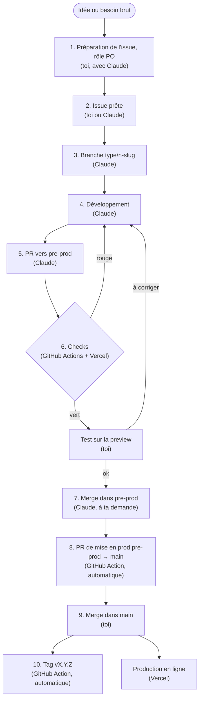

# Software factory

La chaîne de travail qui mène chaque user story de l'idée à la production, sans oubli et sans casse. Ce document est la **carte** de cette chaîne : chaque étape, ce qu'elle reçoit, ce qu'elle doit produire, qui peut la faire, avec quels fichiers. Il est écrit pour un débutant et pour être **recopié dans un autre projet** (les noms propres à Mialigo sont signalés).

- Pourquoi ces choix : [ADR-0023](decisions/0023-software-factory.md) (la factory), [ADR-0024](decisions/0024-carte-factory-commande.md) (cette carte et `/factory`), [ADR-0025](decisions/0025-etapes-interchangeables.md) (étapes interchangeables).
- Version illustrée : [factory.html](factory.html).
- Suivi : epic [#103](https://github.com/MarioHit/mialigo/issues/103). Une fiche par étape dans [`factory/`](factory/) : avant, ce qui change, après.
- **Garder ce fichier à jour** : toute PR qui modifie le fonctionnement de la factory le met aussi à jour (règle d'`AGENTS.md`). Dans Claude Code, la commande **`/factory`** compare ce fichier au dépôt et liste les écarts.

## Le principe : seule compte la sortie

Chaque étape est définie par son **entrée** (ce qu'elle reçoit) et sa **sortie attendue** (ce qu'elle doit produire), pas par celui qui la fait. Une même étape peut être faite :

- par **toi**, à la main ;
- par **Claude** (Claude Code), en suivant `AGENTS.md` ou une commande (`/factory`, plus tard `/story` et `/ship`) ;
- par une **GitHub Action**, un robot déclenché par un événement.

Peu importe l'exécutant : l'étape est réussie si sa sortie respecte ce qui est attendu, et l'étape suivante ne regarde que cette sortie. On peut donc confier une étape à Claude, la reprendre à la main un jour où il le faut, ou l'automatiser plus tard, sans changer le reste de la chaîne.

Seule exception : des **garde-fous** réservent certaines étapes à un exécutant, pour la sécurité (le merge dans `main` reste à toi, le tag reste au robot). Ils sont indiqués dans chaque étape.

## Les acteurs

| Qui                      | C'est quoi                                                                                                                                                           |
| ------------------------ | -------------------------------------------------------------------------------------------------------------------------------------------------------------------- |
| **Toi** (le mainteneur)  | Tu portes aussi le rôle de **PO** (Product Owner : celui qui décide quoi construire et pourquoi). Tu testes sur la preview et tu merges la mise en prod dans `main`. |
| **Claude** (Claude Code) | L'agent : il suit `AGENTS.md` et `CLAUDE.md`, prépare des issues, code, ouvre les PR et merge dans `pre-prod` quand les checks sont verts.                           |
| **GitHub Actions**       | Des robots qui tournent sur les serveurs de GitHub à chaque événement (PR ouverte, merge…), décrits dans `.github/workflows/`.                                       |
| **Vercel**               | L'hébergeur : il construit une preview pour chaque PR et met en ligne `main` (la production).                                                                        |

## Le parcours complet

Entre parenthèses : qui fait l'étape **aujourd'hui**. Les autres exécutants possibles sont détaillés plus bas.

Le statut de l'issue dans le GitHub Project « Mialigo » suit le parcours : **Backlog** (étape 2) → **In progress** (étape 3) → **In review** (étape 7) → **Done** (étape 9, l'issue se ferme).

## Chaque étape en détail

Dans chaque tableau, **Exécutants possibles** liste qui peut faire l'étape (toi, Claude, une GitHub Action) et **Aujourd'hui** qui la fait en pratique. Ce qui doit être respecté, c'est la **sortie attendue**.

### 1. Préparation de l'issue (rôle PO)

|                          |                                                                                                                                                                                              |
| ------------------------ | -------------------------------------------------------------------------------------------------------------------------------------------------------------------------------------------- |
| **Ce qu'elle fait**      | Transforme une idée floue en besoin clair : pour qui, quoi, pourquoi, critères d'acceptation, ce qui est hors périmètre, maquette si c'est visuel, découpage si c'est trop gros pour une PR. |
| **Exécutants possibles** | Toi (seul, ou en discutant avec Claude) ; Claude (commande `/story`, à venir) ; GitHub Action : seulement pour vérifier la forme (champs remplis), pas pour décider du besoin.               |
| **Aujourd'hui**          | Toi, en discutant avec Claude (questions, maquettes HTML).                                                                                                                                   |
| **Entrée**               | Une idée ou un besoin brut (une phrase, un retour d'utilisateur, un bug constaté).                                                                                                           |
| **Sortie attendue**      | Une issue qui respecte la [Definition of Ready](#definition-of-ready-dor--une-issue-est-prête-quand).                                                                                        |
| **Configurée dans**      | `.github/ISSUE_TEMPLATE/user-story.yml`, `bug.yml`, `config.yml` ; Definition of Ready (ce fichier) ; `docs/maquettes/`.                                                                     |

### 2. Issue prête

|                          |                                                                                                              |
| ------------------------ | ------------------------------------------------------------------------------------------------------------ |
| **Ce qu'elle fait**      | Range l'issue dans le suivi : projet, priorité, epic parente, dépendances (« blocked by »).                  |
| **Exécutants possibles** | Toi (sur GitHub) ; Claude (`gh issue create`, `gh project`) ; GitHub Action (ajout automatique au Project).  |
| **Aujourd'hui**          | Toi ou Claude ; l'ajout au Project est automatique (workflow intégré du GitHub Project).                     |
| **Entrée**               | L'issue issue de la préparation.                                                                             |
| **Sortie attendue**      | Une issue numérotée `#n`, dans le Project en **Backlog**, avec label, priorité et liens (epic, dépendances). |
| **Configurée dans**      | `AGENTS.md` (Workflow rules) ; réglages « Workflows » du GitHub Project « Mialigo ».                         |

### 3. Branche

|                          |                                                                                                         |
| ------------------------ | ------------------------------------------------------------------------------------------------------- |
| **Ce qu'elle fait**      | Crée un espace de travail isolé, sans toucher à `pre-prod` ni à `main`.                                 |
| **Exécutants possibles** | Toi (bouton « Create a branch » de l'issue, ou `git`) ; Claude ; GitHub Action (possible, non utilisé). |
| **Aujourd'hui**          | Claude.                                                                                                 |
| **Entrée**               | L'issue `#n` prête.                                                                                     |
| **Sortie attendue**      | Une branche `<type>/<n>-<slug>` partie de `origin/pre-prod` ; issue en **In progress**.                 |
| **Configurée dans**      | `AGENTS.md` (Git rules, Workflow rules), [ADR-0007](decisions/0007-in-progress-debut-travail.md).       |

### 4. Développement

|                          |                                                                                                                                                                                                                      |
| ------------------------ | -------------------------------------------------------------------------------------------------------------------------------------------------------------------------------------------------------------------- |
| **Ce qu'elle fait**      | Réalise l'issue sur la branche : code, documentation, ADR si un choix technique le demande, migration SQL éventuelle.                                                                                                |
| **Exécutants possibles** | Toi, à la main ; Claude (commande `/ship`, à venir) ; GitHub Action (possible avec un agent lancé depuis l'issue, non utilisé).                                                                                      |
| **Aujourd'hui**          | Claude.                                                                                                                                                                                                              |
| **Entrée**               | L'issue prête et sa branche.                                                                                                                                                                                         |
| **Sortie attendue**      | Des commits avec le code, la ligne du `CHANGELOG.md` et la version ; plus un **court rapport** : ce qui a été fait, comment c'est vérifié, ce qui a été supposé. Le rapport est repris dans la description de la PR. |
| **Configurée dans**      | `AGENTS.md` (Changelog and versions), `CLAUDE.md` (code) ; plus tard `.claude/commands/ship.md`.                                                                                                                     |

### 5. Pull request (PR)

|                          |                                                                                                                                                                                                                                                                  |
| ------------------------ | ---------------------------------------------------------------------------------------------------------------------------------------------------------------------------------------------------------------------------------------------------------------- |
| **Ce qu'elle fait**      | Propose les changements de la branche pour `pre-prod`, avec description, façon de tester et checklist « terminé ».                                                                                                                                               |
| **Exécutants possibles** | Toi (sur GitHub) ; Claude (`gh pr create`) ; GitHub Action (possible, non utilisé).                                                                                                                                                                              |
| **Aujourd'hui**          | Claude.                                                                                                                                                                                                                                                          |
| **Entrée**               | La branche et le rapport de développement.                                                                                                                                                                                                                       |
| **Sortie attendue**      | Une PR vers `pre-prod` suivant le modèle, avec `Closes #n` et la Definition of Done cochée pour ce qui est déjà fait (CHANGELOG, version, ADR, migration, docs, secrets) ; les cases « critères vérifiés sur la preview » et « checks verts » restent décochées. |
| **Configurée dans**      | `.github/pull_request_template.md` ; `AGENTS.md`.                                                                                                                                                                                                                |

### 6. Checks et test sur la preview

|                          |                                                                                                                                                                                                                                                                                                                 |
| ------------------------ | --------------------------------------------------------------------------------------------------------------------------------------------------------------------------------------------------------------------------------------------------------------------------------------------------------------- |
| **Ce qu'elle fait**      | Vérifie la PR : pas de secret, pas d'erreur de lint, le site se construit ; Copilot relit la PR et laisse des commentaires ; Vercel publie une **preview** sur laquelle on vérifie les critères d'acceptation. Chaque correction de review suit la règle de relecture d'`AGENTS.md` (voir « Leçons apprises »). |
| **Exécutants possibles** | GitHub Action et Vercel (checks) ; Copilot (review automatique de GitHub) ; toi (test sur la preview) ; Claude (corrections de review, relecture, et plus tard tests automatiques du parcours, étape « tests de bout en bout » de la feuille de route).                                                         |
| **Aujourd'hui**          | GitHub Actions, Vercel et Copilot, puis toi sur la preview ; Claude corrige les retours de review à ta demande.                                                                                                                                                                                                 |
| **Entrée**               | Chaque push sur la PR.                                                                                                                                                                                                                                                                                          |
| **Sortie attendue**      | Tous les checks verts, les critères d'acceptation validés sur la preview, et les cases « critères d'acceptation vérifiés sur la preview » et « tous les checks sont verts » cochées : la checklist est alors complète.                                                                                          |
| **Configurée dans**      | `.github/workflows/gitleaks.yml` (« Scan des secrets », obligatoire), `.github/workflows/lint.yml` (« Lint ») ; Vercel (`vercel.json`, réglages du projet Vercel) ; `.gitleaksignore`.                                                                                                                          |

### 7. Merge dans pre-prod

|                          |                                                                                                                                                                 |
| ------------------------ | --------------------------------------------------------------------------------------------------------------------------------------------------------------- |
| **Ce qu'elle fait**      | Intègre la PR dans `pre-prod`, la branche qui prépare la prochaine version.                                                                                     |
| **Exécutants possibles** | Toi ; Claude, à ta demande. GitHub Action : **exclue volontairement** (le merge automatique n'attendrait pas tous les checks, d'où l'interdiction de `--auto`). |
| **Aujourd'hui**          | Toi ou Claude, uniquement quand **tous** les checks sont verts (`gh pr merge --merge`).                                                                         |
| **Entrée**               | Une PR testée, checks verts, version de `main` revérifiée juste avant.                                                                                          |
| **Sortie attendue**      | `pre-prod` à jour ; branche supprimée ; issue en **In review**.                                                                                                 |
| **Configurée dans**      | `AGENTS.md` (Git rules), [ADR-0005](decisions/0005-apres-merge-pre-prod.md) ; règles de protection de branche sur GitHub.                                       |

### 8. PR de mise en prod

|                          |                                                                                                 |
| ------------------------ | ----------------------------------------------------------------------------------------------- |
| **Ce qu'elle fait**      | Crée (ou complète) la PR `pre-prod` → `main` en y recopiant la description de chaque PR mergée. |
| **Exécutants possibles** | GitHub Action ; Claude ou toi à la main, seulement si le workflow a échoué.                     |
| **Aujourd'hui**          | GitHub Action, automatiquement ; Claude vérifie qu'elle contient `<!-- release-pr:n -->`.       |
| **Entrée**               | Le merge d'une PR dans `pre-prod`.                                                              |
| **Sortie attendue**      | Une seule PR `pre-prod` → `main` ouverte, qui liste tout ce qui partira en prod.                |
| **Configurée dans**      | `.github/workflows/release-pr.yml`, [ADR-0008](decisions/0008-pr-mise-en-prod-automatique.md).  |

### 9. Merge dans main

|                          |                                                                                                                        |
| ------------------------ | ---------------------------------------------------------------------------------------------------------------------- |
| **Ce qu'elle fait**      | Met en production : Vercel publie `main` sur mialigo.com.                                                              |
| **Exécutants possibles** | **Toi uniquement** (garde-fou : Claude n'a jamais le droit de merger dans `main`, aucun robot non plus).               |
| **Aujourd'hui**          | Toi, avec « Create a merge commit ».                                                                                   |
| **Entrée**               | La PR de mise en prod, checks verts ; les migrations SQL éventuelles déjà passées sur la base de prod.                 |
| **Sortie attendue**      | Le site en ligne à jour ; les issues `Closes #n` fermées et passées en **Done**.                                       |
| **Configurée dans**      | `AGENTS.md` (Git rules), [ADR-0006](decisions/0006-merge-commit-seulement.md) ; Vercel (branche de production `main`). |

### 10. Tag de version

|                          |                                                                                                                                           |
| ------------------------ | ----------------------------------------------------------------------------------------------------------------------------------------- |
| **Ce qu'elle fait**      | Pose une étiquette `vX.Y.Z` sur le commit mis en prod, pour retrouver chaque version.                                                     |
| **Exécutants possibles** | **GitHub Action uniquement** (garde-fou : un tag n'est jamais créé ni déplacé à la main) ; Claude ou toi vérifiez seulement qu'il existe. |
| **Aujourd'hui**          | GitHub Action, automatiquement.                                                                                                           |
| **Entrée**               | Le push sur `main` et la version de `package.json`.                                                                                       |
| **Sortie attendue**      | Le tag `vX.Y.Z` (jamais déplacé ni supprimé).                                                                                             |
| **Configurée dans**      | `.github/workflows/version-tag.yml`, [ADR-0011](decisions/0011-tag-version-automatique.md), [ADR-0015](decisions/0015-version-par-pr.md). |

## Aide-mémoire : où se trouve quoi

| Emplacement                                                   | Ce qu'il contient                                                                                                                                  | Qui le lit                   |
| ------------------------------------------------------------- | -------------------------------------------------------------------------------------------------------------------------------------------------- | ---------------------------- |
| `AGENTS.md`                                                   | Les règles de travail : Git (branches, merge, interdits), workflow (issue, Project, ADR), CHANGELOG et versions.                                   | Claude et tout agent de code |
| `CLAUDE.md`                                                   | Le guide du code pour Claude : commandes, architecture, pièges (Supabase, secrets). Il inclut `AGENTS.md`.                                         | Claude                       |
| `.claude/settings.json`                                       | Les réglages de Claude Code partagés dans le dépôt, surtout les **interdictions** (ne jamais lire ni modifier les fichiers `.env`).                | Claude Code                  |
| `.claude/commands/`                                           | Les **commandes personnalisées** : un fichier `x.md` = une commande `/x` à taper dans Claude Code. Ici : `/factory` ; à venir : `/story`, `/ship`. | Claude Code                  |
| `.claude/agents/`                                             | Des **sous-agents** spécialisés (un fichier par agent : rôle, outils permis). _Vide pour l'instant._                                               | Claude Code                  |
| `.claude/skills/`                                             | Des **skills** : des savoir-faire empaquetés (instructions + fichiers) que Claude charge quand la tâche s'y prête. _Vide pour l'instant._          | Claude Code                  |
| `.github/workflows/`                                          | Les **robots GitHub Actions** : `gitleaks.yml`, `lint.yml`, `release-pr.yml`, `version-tag.yml`.                                                   | GitHub                       |
| `.github/ISSUE_TEMPLATE/`, `.github/pull_request_template.md` | Les **modèles** d'issue et de PR.                                                                                                                  | GitHub                       |
| `docs/decisions/`                                             | Les **ADR** : une décision technique par fichier, avec les options écartées. Index dans `README.md`, modèle `0000-modele.md`.                      | Tout le monde                |
| `docs/factory/`                                               | Une **fiche par étape** de construction de la factory (avant, ce qui change, après).                                                               | Toi                          |

## Definition of Ready (DoR) : une issue est prête quand

- elle suit un modèle (User story ou Bug) ;
- la user story dit **qui**, **quoi** et **pourquoi** ;
- elle a des **critères d'acceptation** vérifiables (« Étant donné…, quand…, alors… ») ;
- elle tient dans **une PR** (sinon : une epic et des sous-issues) ;
- elle a une **priorité** (P0 à P4) et ses dépendances sont notées (« blocked by ») ;
- pour un changement visuel important : une **maquette** validée (`docs/maquettes/`).

## Definition of Done (DoD) : une user story est terminée quand

C'est la checklist du modèle de PR :

1. tous les critères d'acceptation sont vérifiés sur la preview ;
2. `CHANGELOG.md` a sa ligne, écrite pour l'utilisateur ;
3. la version est fixée (versionnage sémantique, cf. AGENTS.md) ;
4. une ADR explique tout choix technique significatif ;
5. une migration SQL éventuelle est non destructive, réexécutable et reportée dans le schéma de référence ;
6. la documentation est à jour (dont ce fichier si la factory change) ;
7. aucun secret ni donnée personnelle n'est exposé ;
8. tous les checks sont verts.

La story est **livrée** quand la PR de mise en prod est mergée dans `main` (issue en Done, tag créé).

## Feuille de route

Chaque ligne indique les exécutants possibles de ce que l'étape met en place.

| Étape                                                   | Issue                                                  | Fiche                           | Statut            | Exécutants possibles                            | Apport                                                    |
| ------------------------------------------------------- | ------------------------------------------------------ | ------------------------------- | ----------------- | ----------------------------------------------- | --------------------------------------------------------- |
| 1. Cadre : modèles, DoR / DoD, ADR fondateur            | [#104](https://github.com/MarioHit/mialigo/issues/104) | [01-cadre](factory/01-cadre.md) | en place (v0.9.1) | toi, Claude (GitHub applique les modèles)       | chaque US est bien posée, aucune étape oubliée            |
| 2. Commande `/story` : préparation de l'issue (rôle PO) | à créer                                                | —                               | à faire           | toi (en dialogue), Claude                       | une idée brute devient une issue qui respecte la DoR      |
| 3. Commande `/ship` : développement                     | à créer                                                | —                               | à faire           | Claude, toi                                     | l'issue prête devient code, CHANGELOG, version et rapport |
| 4. CI qualité : TypeScript, build, Dependabot           | [#105](https://github.com/MarioHit/mialigo/issues/105) | —                               | à faire           | GitHub Action                                   | erreurs de type et build cassé bloqués avant Vercel       |
| 5. Tests unitaires (Vitest)                             | [#106](https://github.com/MarioHit/mialigo/issues/106) | —                               | à faire           | GitHub Action (Claude ou toi les écrivent)      | la logique métier est vérifiée à chaque PR                |
| 6. Tests de bout en bout (Playwright sur la preview)    | [#107](https://github.com/MarioHit/mialigo/issues/107) | —                               | à faire           | GitHub Action (Claude ou toi les écrivent)      | le parcours réel est testé automatiquement                |
| 7. Migrations SQL vérifiées en CI                       | [#108](https://github.com/MarioHit/mialigo/issues/108) | —                               | à faire           | GitHub Action                                   | une migration cassée n'atteint pas la prod                |
| 8. Observabilité (Umami, erreurs)                       | [#109](https://github.com/MarioHit/mialigo/issues/109) | —                               | à faire           | toi (installation), GitHub Action (déploiement) | usage et erreurs visibles, sans dépendre d'un tiers       |

Hors étapes : [#115](https://github.com/MarioHit/mialigo/issues/115) (cette carte et la commande `/factory`), [#118](https://github.com/MarioHit/mialigo/issues/118) (étapes interchangeables).

Chaque étape est livrée seule et apporte déjà quelque chose. Sa PR contient :

- son **ADR** (`docs/decisions/`) : le choix technique, les options écartées et pourquoi ;
- sa **fiche d'étape** (`docs/factory/NN-<slug>.md`, d'après [`00-modele.md`](factory/00-modele.md)), en mots simples :
  - **a. Avant** : ce qui se passait sans l'étape, avec des exemples réels ;
  - **b. Ce qui change** : concrètement dans le processus (qui fait quoi, à quel moment) et les impacts (mainteneur, agents, outils, limites) ;
  - **c. Après** : le résultat obtenu et comment le vérifier soi-même ;
- la mise à jour de ce fichier (parcours, tableaux, feuille de route) et de [factory.html](factory.html).

## Leçons apprises

Les incidents de la chaîne et la règle qui en est sortie, pour ne pas les répéter. Une ligne par leçon, la plus récente en haut.

| Date       | Ce qui s'est passé                                                                                                                                                                                                                                                                                                                                                                                         | Leçon et règle                                                                                                                                                                | Où                                                                                         |
| ---------- | ---------------------------------------------------------------------------------------------------------------------------------------------------------------------------------------------------------------------------------------------------------------------------------------------------------------------------------------------------------------------------------------------------------- | ----------------------------------------------------------------------------------------------------------------------------------------------------------------------------- | ------------------------------------------------------------------------------------------ |
| 2026-11-14 | PR [#119](https://github.com/MarioHit/mialigo/pull/119) : Copilot a dû relire deux fois. La correction de son premier commentaire désignait les cases de la DoD par leur position (« les deux dernières »), alors que la case « critères d'acceptation vérifiés sur la preview » est la **première** du modèle de PR. Suivie à la lettre, la consigne aurait laissé la validation sur la preview décochée. | Après chaque correction de review : relire **tout** le passage modifié, le comparer à sa source avant de pousser, et **nommer** les éléments plutôt que donner leur position. | `AGENTS.md` (Workflow rules), issue [#120](https://github.com/MarioHit/mialigo/issues/120) |
| 2026-11-09 | PR #111 mergée sans relire la version de `main`, déjà passée en 0.9.0 : la ligne du CHANGELOG s'est retrouvée dans une version déjà en prod (corrigé par #113, version 0.9.1).                                                                                                                                                                                                                             | Vérifier la version de `main` dans une étape à part, juste avant le merge, et lire le résultat avant de merger.                                                               | `AGENTS.md` (Changelog and versions, point 5)                                              |

## Réutiliser dans un autre projet

1. Copier `.github/` (modèles et workflows), `.claude/` (réglages et commandes), ce document et le dossier `docs/factory/` (les fiches servent d'exemple ; garder `00-modele.md`).
2. Adapter les noms propres : branches (`pre-prod`, `main`), numéro et identifiants du GitHub Project, liens des ADR.
3. Reprendre les règles de travail d'`AGENTS.md` (branches, merge, CHANGELOG, version) et le modèle d'ADR `docs/decisions/0000-modele.md`.
4. Créer les labels de priorité `P0-sécurité`, `P1` à `P4`, `tech`, `enhancement`, `bug`.
5. Lancer `/factory` dans Claude Code pour vérifier que la carte correspond au nouveau dépôt.
