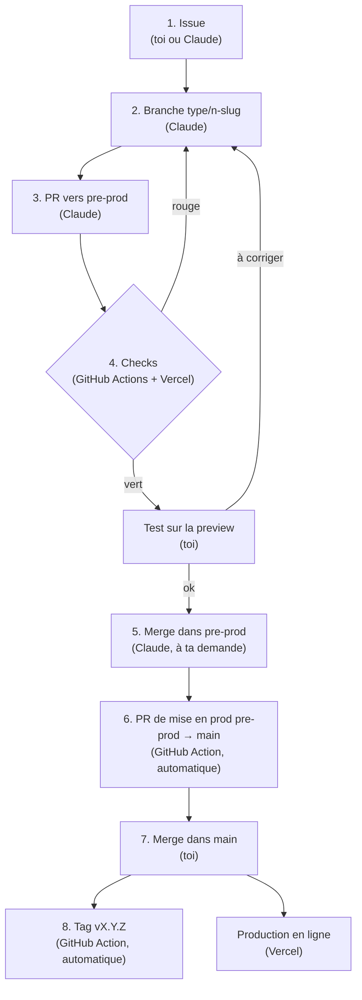

# Software factory

La chaîne de travail qui mène chaque user story de l'idée à la production, sans oubli et sans casse. Ce document est la **carte** de cette chaîne : qui fait quoi, à quel moment, avec quels fichiers. Il est écrit pour un débutant et pour être **recopié dans un autre projet** (les noms propres à Mialigo sont signalés).

- Pourquoi ces choix : [ADR-0023](decisions/0023-software-factory.md) (la factory), [ADR-0024](decisions/0024-carte-factory-commande.md) (cette carte et `/factory`).
- Version illustrée : [factory.html](factory.html).
- Suivi : epic [#103](https://github.com/MarioHit/mialigo/issues/103). Une fiche par étape dans [`factory/`](factory/) : avant, ce qui change, après.
- **Garder ce fichier à jour** : toute PR qui modifie le fonctionnement de la factory le met aussi à jour (règle d'`AGENTS.md`). Dans Claude Code, la commande **`/factory`** compare ce fichier au dépôt et liste les écarts.

## Les acteurs

| Qui                      | C'est quoi                                                                                                                               |
| ------------------------ | ---------------------------------------------------------------------------------------------------------------------------------------- |
| **Toi** (le mainteneur)  | Tu décris le besoin, tu testes sur la preview, tu merges la mise en prod dans `main`.                                                    |
| **Claude** (Claude Code) | L'agent qui code : il suit `AGENTS.md` et `CLAUDE.md`, crée branches, commits, PR, et merge dans `pre-prod` quand les checks sont verts. |
| **GitHub Actions**       | Des robots qui tournent sur les serveurs de GitHub à chaque événement (PR ouverte, merge…), décrits dans `.github/workflows/`.           |
| **Vercel**               | L'hébergeur : il construit une preview pour chaque PR et met en ligne `main` (la production).                                            |

## Le parcours complet

Le statut de l'issue dans le GitHub Project « Mialigo » suit le parcours : **Backlog** → **In progress** (étape 2) → **In review** (étape 5) → **Done** (étape 7, l'issue se ferme).

## Chaque étape en détail

### 1. Issue

|                     |                                                                                                              |
| ------------------- | ------------------------------------------------------------------------------------------------------------ |
| **Ce qu'elle fait** | Décrit le besoin : qui, quoi, pourquoi, et les critères d'acceptation (« Étant donné… quand… alors… »).      |
| **Qui**             | Toi (sur GitHub) ou Claude (avec `gh issue create`).                                                         |
| **Entrée**          | Une idée, un bug, un retour.                                                                                 |
| **Sortie**          | Une issue numérotée `#n`, ajoutée au Project en **Backlog**.                                                 |
| **Configurée dans** | `.github/ISSUE_TEMPLATE/user-story.yml`, `bug.yml`, `config.yml` ; règles dans `AGENTS.md` (Workflow rules). |

### 2. Branche

|                     |                                                                                                   |
| ------------------- | ------------------------------------------------------------------------------------------------- |
| **Ce qu'elle fait** | Crée un espace de travail isolé, sans toucher à `pre-prod` ni à `main`.                           |
| **Qui**             | Claude.                                                                                           |
| **Entrée**          | L'issue `#n`, « prête » (voir Definition of Ready).                                               |
| **Sortie**          | Une branche `<type>/<n>-<slug>` partie de `origin/pre-prod` ; issue en **In progress**.           |
| **Configurée dans** | `AGENTS.md` (Git rules, Workflow rules), [ADR-0007](decisions/0007-in-progress-debut-travail.md). |

### 3. Pull request (PR)

|                     |                                                                                                                    |
| ------------------- | ------------------------------------------------------------------------------------------------------------------ |
| **Ce qu'elle fait** | Propose les changements de la branche pour `pre-prod`, avec description, façon de tester et checklist « terminé ». |
| **Qui**             | Claude.                                                                                                            |
| **Entrée**          | Les commits de la branche (code, `CHANGELOG.md`, version, ADR, docs).                                              |
| **Sortie**          | Une PR vers `pre-prod` contenant `Closes #n`.                                                                      |
| **Configurée dans** | `.github/pull_request_template.md` ; `AGENTS.md` (Changelog and versions).                                         |

### 4. Checks

|                     |                                                                                                                                                                                        |
| ------------------- | -------------------------------------------------------------------------------------------------------------------------------------------------------------------------------------- |
| **Ce qu'elle fait** | Vérifie automatiquement la PR : pas de secret, pas d'erreur de lint, le site se construit. Vercel publie une **preview** que tu testes.                                                |
| **Qui**             | GitHub Actions et Vercel ; puis toi pour le test sur la preview.                                                                                                                       |
| **Entrée**          | Chaque push sur la PR.                                                                                                                                                                 |
| **Sortie**          | Des checks verts ou rouges sur la PR, et l'URL de la preview.                                                                                                                          |
| **Configurée dans** | `.github/workflows/gitleaks.yml` (« Scan des secrets », obligatoire), `.github/workflows/lint.yml` (« Lint ») ; Vercel (`vercel.json`, réglages du projet Vercel) ; `.gitleaksignore`. |

### 5. Merge dans pre-prod

|                     |                                                                                                                              |
| ------------------- | ---------------------------------------------------------------------------------------------------------------------------- |
| **Ce qu'elle fait** | Intègre la PR dans `pre-prod`, la branche qui prépare la prochaine version.                                                  |
| **Qui**             | Claude, à ta demande, uniquement quand **tous** les checks sont verts (`gh pr merge --merge`, jamais `--admin` ni `--auto`). |
| **Entrée**          | Une PR testée, checks verts, version de `main` revérifiée juste avant.                                                       |
| **Sortie**          | `pre-prod` à jour ; branche supprimée ; issue en **In review**.                                                              |
| **Configurée dans** | `AGENTS.md` (Git rules), [ADR-0005](decisions/0005-apres-merge-pre-prod.md) ; règles de protection de branche sur GitHub.    |

### 6. PR de mise en prod

|                     |                                                                                                 |
| ------------------- | ----------------------------------------------------------------------------------------------- |
| **Ce qu'elle fait** | Crée (ou complète) la PR `pre-prod` → `main` en y recopiant la description de chaque PR mergée. |
| **Qui**             | GitHub Action, automatiquement ; Claude vérifie qu'elle contient `<!-- release-pr:n -->`.       |
| **Entrée**          | Le merge d'une PR dans `pre-prod`.                                                              |
| **Sortie**          | Une seule PR `pre-prod` → `main` ouverte, qui liste tout ce qui partira en prod.                |
| **Configurée dans** | `.github/workflows/release-pr.yml`, [ADR-0008](decisions/0008-pr-mise-en-prod-automatique.md).  |

### 7. Merge dans main

|                     |                                                                                                                        |
| ------------------- | ---------------------------------------------------------------------------------------------------------------------- |
| **Ce qu'elle fait** | Met en production : Vercel publie `main` sur mialigo.com.                                                              |
| **Qui**             | **Toi uniquement** (Claude n'a jamais le droit de merger dans `main`), avec « Create a merge commit ».                 |
| **Entrée**          | La PR de mise en prod, checks verts ; les migrations SQL éventuelles déjà passées sur la base de prod.                 |
| **Sortie**          | Le site en ligne à jour ; les issues `Closes #n` fermées et passées en **Done**.                                       |
| **Configurée dans** | `AGENTS.md` (Git rules), [ADR-0006](decisions/0006-merge-commit-seulement.md) ; Vercel (branche de production `main`). |

### 8. Tag de version

|                     |                                                                                                                                           |
| ------------------- | ----------------------------------------------------------------------------------------------------------------------------------------- |
| **Ce qu'elle fait** | Pose une étiquette `vX.Y.Z` sur le commit mis en prod, pour retrouver chaque version.                                                     |
| **Qui**             | GitHub Action, automatiquement ; Claude vérifie ensuite qu'il existe.                                                                     |
| **Entrée**          | Le push sur `main` et la version de `package.json`.                                                                                       |
| **Sortie**          | Le tag `vX.Y.Z` (jamais déplacé ni supprimé).                                                                                             |
| **Configurée dans** | `.github/workflows/version-tag.yml`, [ADR-0011](decisions/0011-tag-version-automatique.md), [ADR-0015](decisions/0015-version-par-pr.md). |

## Aide-mémoire : où se trouve quoi

| Emplacement                                                   | Ce qu'il contient                                                                                                                         | Qui le lit                   |
| ------------------------------------------------------------- | ----------------------------------------------------------------------------------------------------------------------------------------- | ---------------------------- |
| `AGENTS.md`                                                   | Les règles de travail : Git (branches, merge, interdits), workflow (issue, Project, ADR), CHANGELOG et versions.                          | Claude et tout agent de code |
| `CLAUDE.md`                                                   | Le guide du code pour Claude : commandes, architecture, pièges (Supabase, secrets). Il inclut `AGENTS.md`.                                | Claude                       |
| `.claude/settings.json`                                       | Les réglages de Claude Code partagés dans le dépôt, surtout les **interdictions** (ne jamais lire ni modifier les fichiers `.env`).       | Claude Code                  |
| `.claude/commands/`                                           | Les **commandes personnalisées** : un fichier `x.md` = une commande `/x` à taper dans Claude Code. Ici : `/factory`.                      | Claude Code                  |
| `.claude/agents/`                                             | Des **sous-agents** spécialisés (un fichier par agent : rôle, outils permis). _Vide pour l'instant._                                      | Claude Code                  |
| `.claude/skills/`                                             | Des **skills** : des savoir-faire empaquetés (instructions + fichiers) que Claude charge quand la tâche s'y prête. _Vide pour l'instant._ | Claude Code                  |
| `.github/workflows/`                                          | Les **robots GitHub Actions** : `gitleaks.yml`, `lint.yml`, `release-pr.yml`, `version-tag.yml`.                                          | GitHub                       |
| `.github/ISSUE_TEMPLATE/`, `.github/pull_request_template.md` | Les **modèles** d'issue et de PR.                                                                                                         | GitHub                       |
| `docs/decisions/`                                             | Les **ADR** : une décision technique par fichier, avec les options écartées. Index dans `README.md`, modèle `0000-modele.md`.             | Tout le monde                |
| `docs/factory/`                                               | Une **fiche par étape** de construction de la factory (avant, ce qui change, après).                                                      | Toi                          |

## Definition of Ready (DoR) : une issue est prête quand

- elle suit un modèle (User story ou Bug) ;
- la user story dit **qui**, **quoi** et **pourquoi** ;
- elle a des **critères d'acceptation** vérifiables (« Étant donné…, quand…, alors… ») ;
- elle tient dans **une PR** (sinon : une epic et des sous-issues) ;
- elle a une **priorité** (P0 à P4) et ses dépendances sont notées (« blocked by ») ;
- pour un changement visuel important : une **maquette** validée (`docs/maquettes/`).

## Definition of Done (DoD) : une user story est terminée quand

C'est la checklist du modèle de PR :

1. tous les critères d'acceptation sont vérifiés sur la preview ;
2. `CHANGELOG.md` a sa ligne, écrite pour l'utilisateur ;
3. la version est fixée (versionnage sémantique, cf. AGENTS.md) ;
4. une ADR explique tout choix technique significatif ;
5. une migration SQL éventuelle est non destructive, réexécutable et reportée dans le schéma de référence ;
6. la documentation est à jour (dont ce fichier si la factory change) ;
7. aucun secret ni donnée personnelle n'est exposé ;
8. tous les checks sont verts.

La story est **livrée** quand la PR de mise en prod est mergée dans `main` (issue en Done, tag créé).

## Feuille de route

| Étape                                                | Issue                                                  | Fiche                           | Statut            | Apport                                              |
| ---------------------------------------------------- | ------------------------------------------------------ | ------------------------------- | ----------------- | --------------------------------------------------- |
| 1. Cadre : modèles, DoR / DoD, ADR fondateur         | [#104](https://github.com/MarioHit/mialigo/issues/104) | [01-cadre](factory/01-cadre.md) | en place (v0.9.1) | chaque US est bien posée, aucune étape oubliée      |
| 2. CI qualité : TypeScript, build, Dependabot        | [#105](https://github.com/MarioHit/mialigo/issues/105) | —                               | à faire           | erreurs de type et build cassé bloqués avant Vercel |
| 3. Tests unitaires (Vitest)                          | [#106](https://github.com/MarioHit/mialigo/issues/106) | —                               | à faire           | la logique métier est vérifiée à chaque PR          |
| 4. Tests de bout en bout (Playwright sur la preview) | [#107](https://github.com/MarioHit/mialigo/issues/107) | —                               | à faire           | le parcours réel est testé automatiquement          |
| 5. Migrations SQL vérifiées en CI                    | [#108](https://github.com/MarioHit/mialigo/issues/108) | —                               | à faire           | une migration cassée n'atteint pas la prod          |
| 6. Observabilité (Umami, erreurs)                    | [#109](https://github.com/MarioHit/mialigo/issues/109) | —                               | à faire           | usage et erreurs visibles, sans dépendre d'un tiers |

Hors étapes : [#115](https://github.com/MarioHit/mialigo/issues/115), cette carte et la commande `/factory`.

Chaque étape est livrée seule et apporte déjà quelque chose. Sa PR contient :

- son **ADR** (`docs/decisions/`) : le choix technique, les options écartées et pourquoi ;
- sa **fiche d'étape** (`docs/factory/NN-<slug>.md`, d'après [`00-modele.md`](factory/00-modele.md)), en mots simples :
  - **a. Avant** : ce qui se passait sans l'étape, avec des exemples réels ;
  - **b. Ce qui change** : concrètement dans le processus (qui fait quoi, à quel moment) et les impacts (mainteneur, agents, outils, limites) ;
  - **c. Après** : le résultat obtenu et comment le vérifier soi-même ;
- la mise à jour de ce fichier (parcours, tableaux, feuille de route) et de [factory.html](factory.html).

## Réutiliser dans un autre projet

1. Copier `.github/` (modèles et workflows), `.claude/` (réglages et commandes), ce document et le dossier `docs/factory/` (les fiches servent d'exemple ; garder `00-modele.md`).
2. Adapter les noms propres : branches (`pre-prod`, `main`), numéro et identifiants du GitHub Project, liens des ADR.
3. Reprendre les règles de travail d'`AGENTS.md` (branches, merge, CHANGELOG, version) et le modèle d'ADR `docs/decisions/0000-modele.md`.
4. Créer les labels de priorité `P0-sécurité`, `P1` à `P4`, `tech`, `enhancement`, `bug`.
5. Lancer `/factory` dans Claude Code pour vérifier que la carte correspond au nouveau dépôt.
