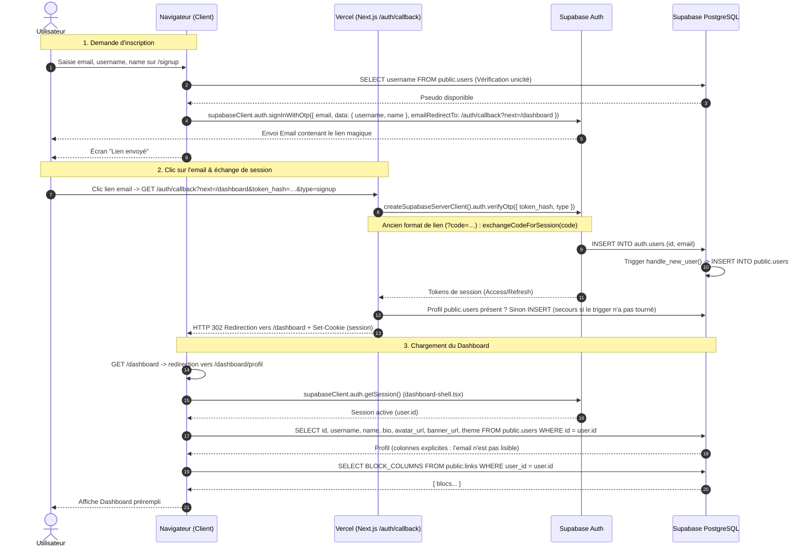

# Workflow Inscription & Validation Magic Link

Ce document décrit le flux complet d'inscription d'un nouvel utilisateur, depuis la saisie du formulaire jusqu'à la création du profil et l'accès au tableau de bord.

---

## 1. Description des étapes

1. **Vérification du pseudo (`/signup`) :**
   - Le client saisit un pseudo (ex: `mialigo.com/mario`).
   - Vérification en temps réel dans `public.users` pour s'assurer de sa disponibilité.
2. **Demande de Magic Link :**
   - Le client envoie son email et ses métadonnées (`username`, `name`).
   - Supabase Auth génère un jeton sécurisé et expédie l'email avec un lien pointant vers `/auth/callback?next=/dashboard`.
3. **Validation & Création de session (`/auth/callback`) :**
   - Au clic sur le lien dans l'email, le serveur Next.js intercepte le `code` ou `token_hash`.
   - Échange avec Supabase pour créer la session et enregistrer les cookies HTTP sécurisés.
   - Création / synchronisation du profil dans `public.users`.
4. **Accès au Dashboard (`/dashboard`) :**
   - Redirection vers le tableau de bord avec les données utilisateur pré-remplies.

---

## 2. Diagramme de Séquence UML

---

## 3. Logs de diagnostic associés

Les logs `debug()` n'apparaissent qu'en développement et ne contiennent ni email, ni identifiant, ni jeton.

- `[Signup] Vérification de la disponibilité du pseudo.`
- `[Signup] Pseudo disponible.` / `[Signup] Pseudo indisponible.` / `[Signup] Pseudo réservé.`
- `[Signup] Envoi de la demande de création de compte.`
- `[Signup] Lien de confirmation envoyé.`
- `[Auth/Callback] Requête reçue.`
- `[Auth/Callback] Validation du lien magique par token hash.` puis `[Auth/Callback] Lien magique validé.`
- `[Auth/Callback] Création du profil absent.` / `[Auth/Callback] Profil existant confirmé.`
- `[Auth/Callback] Authentification réussie, redirection en cours.`
