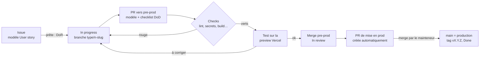

# Software factory

La chaîne de travail qui mène chaque user story de l'idée à la production, sans oubli et sans casse. Ce document est écrit pour être **recopié dans un autre projet** : les noms propres à Mialigo sont signalés.

- Pourquoi ces choix : [ADR-0023](decisions/0023-software-factory.md).
- Version illustrée pour débuter : [factory.html](factory.html).
- Suivi : epic [#103](https://github.com/MarioHit/mialigo/issues/103).

## Le parcours d'une user story

| Étape | Qui | Outil | Ce qui est garanti |
|---|---|---|---|
| Écrire l'issue | mainteneur | modèle `.github/ISSUE_TEMPLATE/user-story.yml` | le besoin et ses critères d'acceptation sont écrits avant le code |
| Démarrer | développeur ou agent | GitHub Project (Backlog → In progress) | on sait ce qui est en cours |
| Ouvrir la PR | développeur ou agent | modèle `.github/pull_request_template.md` | la checklist « terminé » est sous les yeux |
| Checks | GitHub Actions, Vercel | `lint.yml`, `gitleaks.yml`, build Vercel (puis étapes 2 à 5) | rien de cassé ni de secret n'entre |
| Tester | mainteneur | preview Vercel de la PR | les critères d'acceptation sont vérifiés en vrai |
| Mettre en prod | mainteneur | `release-pr.yml`, `version-tag.yml` | une version taguée par mise en prod, CHANGELOG à jour |

## Definition of Ready (DoR) : une issue est prête quand

- elle suit un modèle (User story ou Bug) ;
- la user story dit **qui**, **quoi** et **pourquoi** ;
- elle a des **critères d'acceptation** vérifiables (« Étant donné…, quand…, alors… ») ;
- elle tient dans **une PR** (sinon : une epic et des sous-issues) ;
- elle a une **priorité** (P0 à P4) et ses dépendances sont notées (« blocked by ») ;
- pour un changement visuel important : une **maquette** validée (`docs/maquettes/`).

## Definition of Done (DoD) : une user story est terminée quand

C'est la checklist du modèle de PR :

1. tous les critères d'acceptation sont vérifiés sur la preview ;
2. `CHANGELOG.md` a sa ligne, écrite pour l'utilisateur ;
3. la version est fixée (versionnage sémantique, cf. AGENTS.md) ;
4. une ADR explique tout choix technique significatif ;
5. une migration SQL éventuelle est non destructive, réexécutable et reportée dans le schéma de référence ;
6. la documentation est à jour ;
7. aucun secret ni donnée personnelle n'est exposé ;
8. tous les checks sont verts.

La story est **livrée** quand la PR de mise en prod est mergée dans `main` (issue en Done, tag créé).

## Feuille de route

| Étape | Issue | Statut | Apport |
|---|---|---|---|
| 1. Cadre : modèles, DoR / DoD, ADR fondateur | [#104](https://github.com/MarioHit/mialigo/issues/104) | en cours | chaque US est bien posée, aucune étape oubliée |
| 2. CI qualité : TypeScript, build, Dependabot | [#105](https://github.com/MarioHit/mialigo/issues/105) | à faire | erreurs de type et build cassé bloqués avant Vercel |
| 3. Tests unitaires (Vitest) | [#106](https://github.com/MarioHit/mialigo/issues/106) | à faire | la logique métier est vérifiée à chaque PR |
| 4. Tests de bout en bout (Playwright sur la preview) | [#107](https://github.com/MarioHit/mialigo/issues/107) | à faire | le parcours réel est testé automatiquement |
| 5. Migrations SQL vérifiées en CI | [#108](https://github.com/MarioHit/mialigo/issues/108) | à faire | une migration cassée n'atteint pas la prod |
| 6. Observabilité (Umami, erreurs) | [#109](https://github.com/MarioHit/mialigo/issues/109) | à faire | usage et erreurs visibles, sans dépendre d'un tiers |

Chaque étape est livrée seule et apporte déjà quelque chose ; chacune a son ADR.

## Réutiliser dans un autre projet

1. Copier `.github/ISSUE_TEMPLATE/`, `.github/pull_request_template.md`, `.github/workflows/` et ce document.
2. Adapter les noms propres : branches (`pre-prod`, `main`), numéro et identifiants du GitHub Project, liens des ADR.
3. Reprendre les règles de travail d'`AGENTS.md` (branches, merge, CHANGELOG, version) et le modèle d'ADR `docs/decisions/0000-modele.md`.
4. Créer les labels de priorité `P0-sécurité`, `P1` à `P4`, `tech`, `enhancement`, `bug`.
