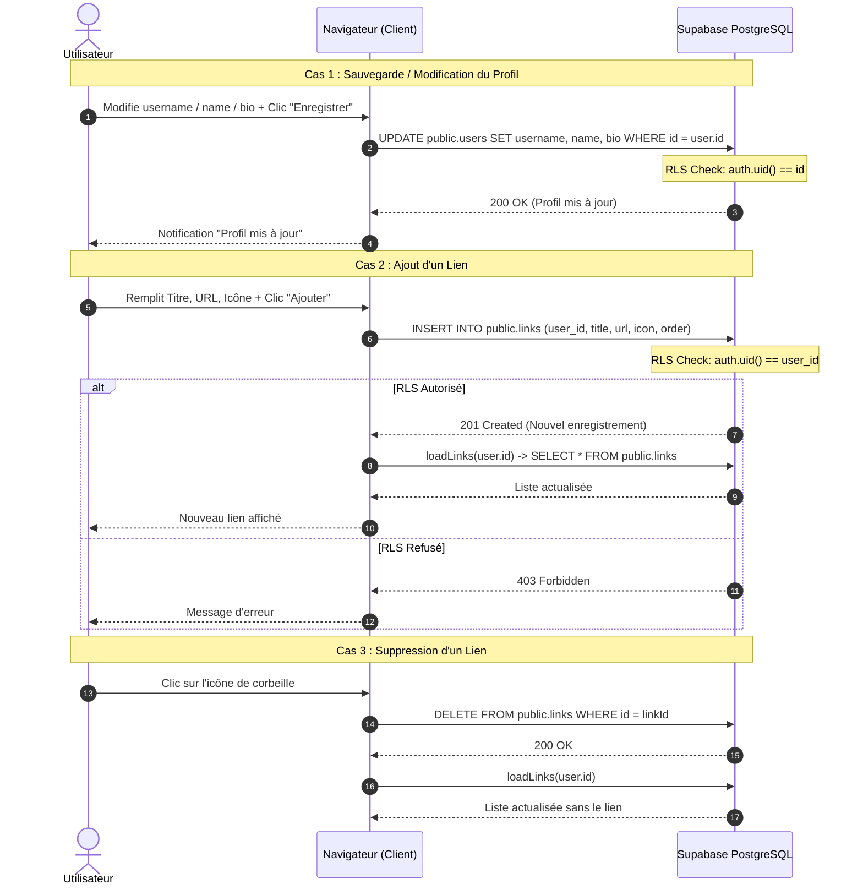

# Workflow Gestion des Liens & Profil Dashboard

Ce document décrit le cycle de vie des données (création, mise à jour, suppression de liens et édition du profil) depuis l'interface d'administration `/dashboard`.

Organisation du dashboard :

- `/dashboard` redirige vers `/dashboard/profil` (c'est l'URL d'arrivée du magic link).
- `app/dashboard/layout.tsx` enveloppe toutes les sous-pages dans `DashboardShell` (`app/dashboard/dashboard-shell.tsx`, composant client) : vérification de session (sinon `/login`), chargement du profil et des blocs, en-tête (« Voir ma page », déconnexion), onglets et **aperçu en direct**. Les sous-pages lisent `user`, `profile`, `reloadProfile()`, `blocks`, `reloadBlocks()` avec `useDashboard()`, et y poussent leurs brouillons (`setProfileDraft`, `setEditDraft`, `setNewDraft`).
- `/dashboard/profil` (`app/dashboard/profil/page.tsx`) : pseudo, nom affiché, bio, et le bloc « Photo et bannière » (`profile-images.tsx`, action serveur `actions.ts`).
- `/dashboard/blocs` (`app/dashboard/blocs/page.tsx`) : liste, ajout, modification et suppression des liens ; réorganisation par drag & drop (`@dnd-kit`, poignée, clavier : Espace puis flèches) et choix de la taille (petit / large / grand) de chaque bloc.


### Blocs et aperçu en direct

Voir [ADR-0017](decisions/0017-modele-blocs-registre-apercu.md). Chaque ligne de `public.links` est un bloc typé (`type`, `data`, `size` ; `title` / `url` / `icon` pour le type `link`), lu avec `BLOCK_COLUMNS` / `toBlocks()` (`lib/blocks.ts`) et rendu par le registre `components/blocks/registry.tsx`. `components/profile-view.tsx` affiche la page (bannière, photo, nom, bio, blocs) à l'identique sur `/<pseudo>` et dans l'aperçu.

L'aperçu combine les données enregistrées et les brouillons : nom et bio en cours de saisie (`/dashboard/profil`), lien en cours d'édition ou d'ajout (`/dashboard/blocs`). Les brouillons sont effacés à l'enregistrement, à l'annulation ou en quittant la page. Aucune requête n'est faite pendant la saisie.


### Ordre et tailles (grille bento)

Voir [ADR-0018](decisions/0018-drag-drop-dnd-kit-grille-bento.md). La page affiche les blocs dans une grille à 2 colonnes (`BlockList`, `grid-flow-row-dense`) : `small` 1×1, `wide` 2×1 (défaut, la ligne habituelle), `large` 2×2. Dans le dashboard, déposer un lien à une nouvelle place met à jour l'aperçu tout de suite, puis enregistre tout l'ordre en une requête : `rpc("reorder_blocks", { ids })` (`SECURITY INVOKER`, filtrée sur `auth.uid()`). En cas d'échec, les blocs sont relus. Le changement de taille est un `update` de `links.size`.


### Réorganiser depuis sa page publique

Voir [ADR-0019](decisions/0019-reorganiser-sur-la-page-publique.md). Sur `/<pseudo>`, le propriétaire (id de la session = `ownerId` transmis par `page.tsx`) voit un bouton « Réorganiser » (s'il a au moins deux blocs). Le mode charge `components/blocks/sortable-block-grid.tsx` à la demande : souris (5 px), appui long sur mobile (250 ms), clavier ; la vraie grille se réarrange pendant le glisser. « Enregistrer l'ordre » appelle `rpc("reorder_blocks", { ids })` (protégé par la RLS), puis `router.refresh()` ; « Annuler » rétablit l'ordre enregistré.

---

## 1. Description des actions

1. **Mise à jour du profil :**
   - L'utilisateur met à jour son `username`, `name` ou `bio`.
   - La requête utilise `update` (ou `insert` si le profil est absent) avec vérification RLS (`auth.uid() = id`). Pas d'`upsert` : il exigerait de lire la colonne `email`, non exposée via l'API.
2. **Ajout d'un nouveau lien :**
   - L'utilisateur sélectionne un titre, une URL et une icône de réseau social.
   - Insertion dans `public.links` avec calcul automatique de l'ordre d'affichage.
3. **Édition / Suppression d'un lien :**
   - Modification directe ou suppression sécurisée protégée par RLS (`auth.uid() = user_id`).

---

## 2. Diagramme de Séquence UML



---

## 3. Logs de diagnostic associés

- `[Dashboard] 💾 Sauvegarde du profil... { id, username, name, bio }`
- `[Dashboard] ✅ Profil sauvegardé / mis à jour avec succès.`
- `[Dashboard] ➕ Ajout d'un nouveau lien... { title, url, icon, order }`
- `[Dashboard] ✅ Lien ajouté avec succès.`
- `[Dashboard] 🗑️ Suppression du lien ID: "<linkId>"`
- `[Dashboard] 💾 Mise à jour du lien ID: "<linkId>"`

---

## Photo de profil et bannière

Voir [ADR-0016](decisions/0016-photo-profil-banniere-storage.md). Images dans le bucket Supabase Storage public `avatars`, un dossier par utilisateur (`<id>/avatar-<horodatage>.webp`, `<id>/banner-…`), URL publiques dans `users.avatar_url` / `users.banner_url` (script `supabase-avatars.sql`).

- **Envoi** : recadrage centré et redimensionnement dans le navigateur (avatar 400 × 400, bannière 1500 × 500, WebP), envoi direct au bucket, mise à jour du profil, puis suppression de l'ancien fichier.
- **Gravatar / GitHub** : action serveur `importAvatar` ; l'email n'est lu que dans la session, l'empreinte SHA-256 n'est envoyée qu'à Gravatar, l'image est copiée dans le bucket.
- **Suppression** : `avatar_url` / `banner_url` à `NULL`, puis suppression du fichier.

```mermaid
sequenceDiagram
    autonumber
    actor User as Utilisateur
    participant Browser as Navigateur (Client)
    participant Action as Action serveur (Vercel)
    participant Ext as Gravatar / GitHub
    participant Storage as Supabase Storage
    participant SupaDB as Supabase PostgreSQL

    Note over User, SupaDB: Cas 1 : Envoi d'une image
    User->>Browser: Choisit un fichier
    Browser->>Browser: Recadrage + redimensionnement (canvas, WebP)
    Browser->>Storage: upload avatars/<id>/avatar-<ts>.webp
    Note over Storage: Policy : dossier = auth.uid()
    Browser->>SupaDB: UPDATE users SET avatar_url WHERE id = user.id
    Browser->>Storage: remove(ancien fichier)

    Note over User, SupaDB: Cas 2 : Import Gravatar ou GitHub
    User->>Browser: « Utiliser mon Gravatar » / pseudo GitHub
    Browser->>Action: importAvatar(source, pseudo)
    Action->>Action: getUser() (session) ; SHA-256 de l'email pour Gravatar
    Action->>Ext: GET image (d=404 / size=400)
    Ext-->>Action: image ou 404
    Action->>Storage: upload avatars/<id>/avatar-<ts>.<ext> (session utilisateur)
    Action->>SupaDB: UPDATE users SET avatar_url
    Action->>Storage: remove(ancien fichier)
    Action-->>Browser: { ok, avatarUrl } ou { ok: false, error }
```

